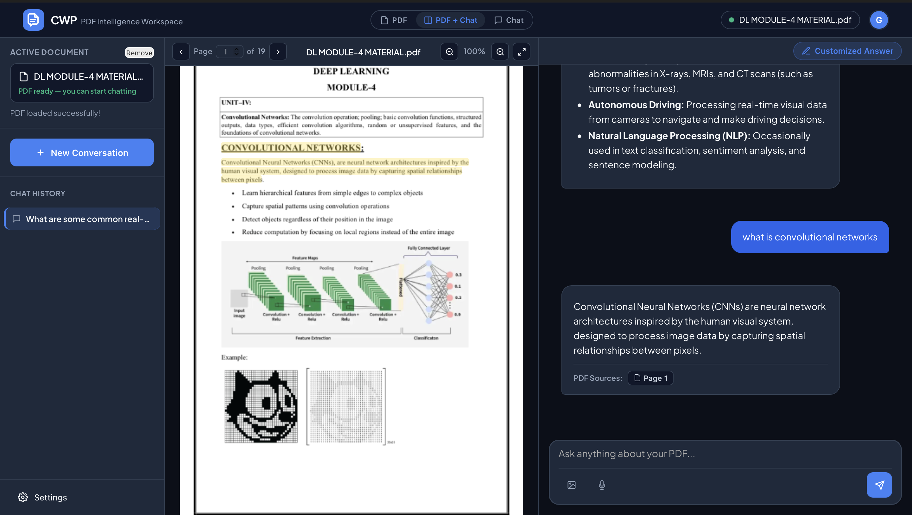
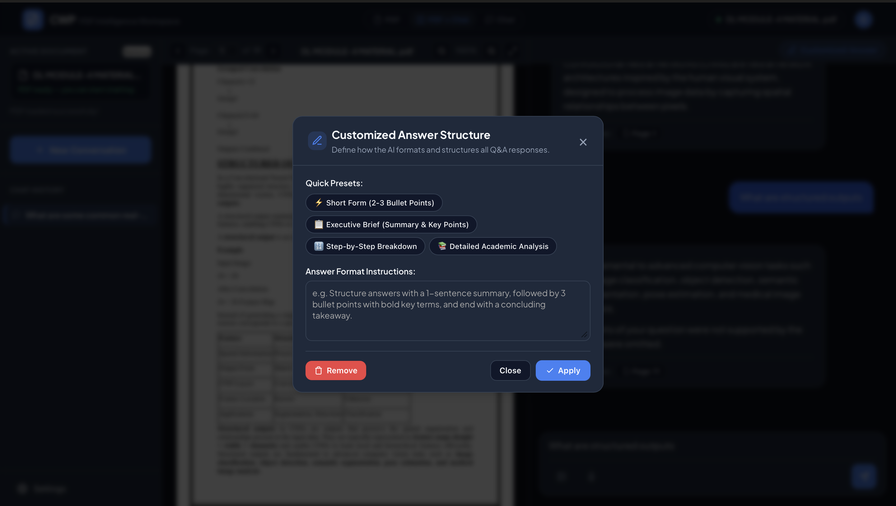
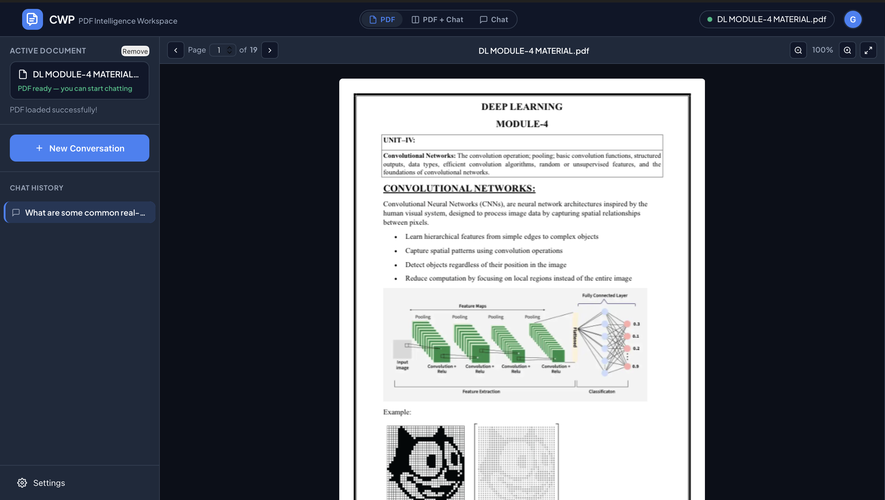
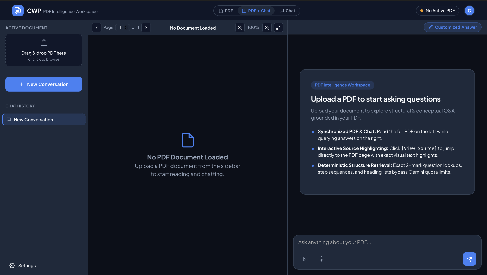
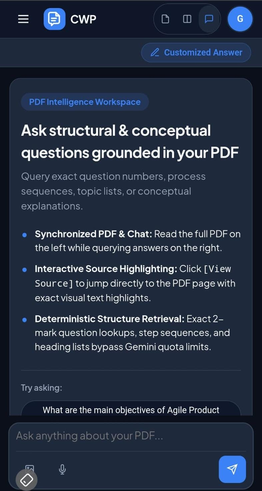
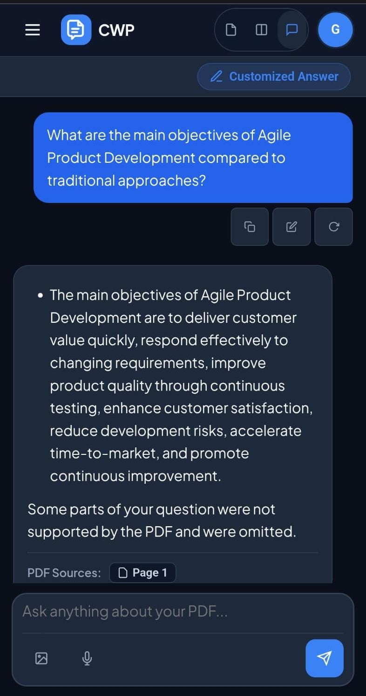
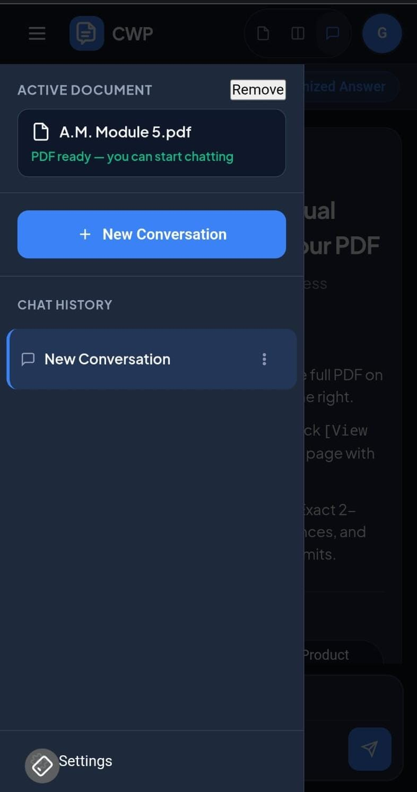
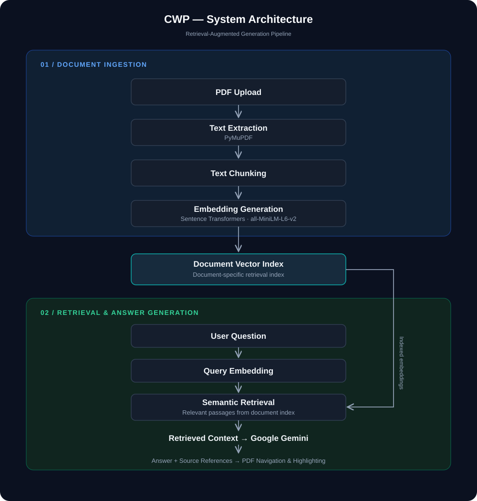

 <div align="center">


<br/>

# CWP — Chat with PDF

**Ask questions. Understand documents. Find the answers that matter.**

A Retrieval-Augmented Generation (RAG) application that lets users upload PDF documents, ask questions in natural language, and receive context-aware answers supported by references to the original document.

[Live Demo](https://cwp-chat-with-pdf.onrender.com/) · [GitHub Repository](https://github.com/Kruthika-Pallapolu/chat-with-pdf)

</div>

---

## Overview

CWP (Chat with PDF) is a document question-answering application built around Retrieval-Augmented Generation (RAG). It allows users to interact with PDF documents through a conversational interface instead of manually searching through pages.

When a document is uploaded, its text is extracted, divided into smaller chunks, converted into numerical embeddings, and indexed for semantic retrieval. When a user asks a question, the application retrieves relevant document passages and provides them as context to the language model to generate an answer.

CWP also connects generated answers to their supporting document passages. Users can follow source references to navigate to the relevant PDF page and view the highlighted supporting text.

A key part of the project is its **Customized Answer** functionality, which uses personalized answer preferences to make responses more relevant to the user's preferred explanation style.

## Screenshots

### Split Workspace

View the PDF and chat interface side by side while asking questions about the document.



### Customized Answer

Get answers tailored using the application's personalized answer functionality.



### PDF Viewer

Read and navigate the uploaded PDF directly inside the application.



### Workspace

A clean workspace before uploading a document.



### Mobile Experience

<div align="center">
  
  &nbsp;&nbsp;&nbsp;&nbsp;
  
  &nbsp;&nbsp;&nbsp;&nbsp;
  
</div>

---

## Key Features

- **PDF-Based Question Answering:** Upload a PDF and ask questions about its content using natural language.
- **Retrieval-Augmented Generation:** Combines semantic document retrieval with Gemini-generated responses grounded in retrieved context.
- **Semantic Search:** Uses sentence embeddings to identify relevant passages based on meaning rather than exact keyword matches.
- **Source References:** Answers include references to the document passages used to generate them.
- **PDF Passage Highlighting:** Select a source reference to navigate to its corresponding PDF page and highlight the supporting passage.
- **Customized Answers:** Personalize responses using the application's answer customization functionality.
- **Suggested Questions:** Get suggested questions after uploading a document to help explore its content.
- **Document-Aware Responses:** Uses retrieved document context when answering questions about the uploaded PDF.
- **General Knowledge Fallback:** Supports questions beyond the uploaded document through a separate general-knowledge response path.
- **Multiple Workspace Modes:** Switch between split, PDF-focused, and chat-focused layouts.
- **Conversation Management:** Access and manage conversations associated with the current session.
- **Document Replacement:** Upload another PDF to begin working with a different document.
- **Responsive Interface:** Provides a usable experience across desktop and mobile screen sizes.
- **Session Isolation:** Keeps document and conversation data scoped to individual application sessions.

## How It Works

CWP follows a two-stage RAG workflow: document ingestion and question answering.

### 1. Document Ingestion

When a PDF is uploaded, the application extracts its text and prepares it for semantic retrieval.

1. **PDF Upload:** The user uploads a PDF through the application interface.
2. **Text Extraction:** PyMuPDF extracts text and page-level information from the document.
3. **Text Chunking:** Extracted content is divided into smaller chunks suitable for embedding and retrieval.
4. **Embedding Generation:** The Sentence Transformers model `all-MiniLM-L6-v2` converts text chunks into vector embeddings.
5. **Document Indexing:** The generated embeddings and associated document information are stored for retrieval.

### 2. Question Answering

When the user submits a question, CWP searches the indexed document for relevant content and uses that context to generate a response.

1. **Question Input:** The user submits a question through the chat interface.
2. **Query Embedding:** The question is converted into an embedding using the same embedding model.
3. **Semantic Retrieval:** The application searches for relevant document chunks using vector similarity.
4. **Context Preparation:** Retrieved passages are prepared as context for the language model.
5. **Answer Generation:** Google Gemini generates a response using the retrieved context.
6. **Source References:** The application associates the answer with supporting document passages.
7. **PDF Navigation:** Selecting a source reference navigates to the relevant PDF page and highlights the corresponding passage.

## System Architecture

The following diagram illustrates the overall architecture and interaction between the document ingestion, retrieval, and answer-generation components.

<p align="center">
  
</p>

## Technology Stack

| Category | Technologies |
|---|---|
| Backend | Python, FastAPI |
| Frontend | HTML, CSS, JavaScript |
| PDF Processing | PyMuPDF, PDF.js |
| Embeddings | Sentence Transformers |
| Embedding Model | all-MiniLM-L6-v2 |
| Similarity Search | scikit-learn |
| Language Model | Google Gemini |
| Validation | Pydantic |
| Testing | pytest, JavaScript checks |
| Deployment | Render |
| Version Control | Git, GitHub |

## Project Structure

```text
CWP/
├── public/
│   ├── app.js
│   ├── highlight.js
│   ├── index.html
│   ├── style.css
│   └── ...
├── src/
│   ├── chunker.py
│   ├── document_search.py
│   ├── embedder.py
│   ├── generator.py
│   ├── pdf_loader.py
│   ├── search.py
│   ├── session_store.py
│   └── storage.py
├── tests/
├── docs/
│   ├── architecture.svg
│   └── screenshots/
├── server.py
├── requirements.txt
├── constraints.txt
├── .env.example
└── README.md
```

## Getting Started

Follow these steps to run CWP locally.

### Prerequisites

- Python 3.12
- Git
- A Google Gemini API key

### 1. Clone the Repository

```bash
git clone https://github.com/Kruthika-Pallapolu/chat-with-pdf.git
cd chat-with-pdf
```

### 2. Create a Virtual Environment

```bash
python3.12 -m venv venv
```

Activate the environment:

**macOS / Linux**

```bash
source venv/bin/activate
```

**Windows**

```bash
venv\Scripts\activate
```

### 3. Install Dependencies

```bash
pip install -r requirements.txt
```

### 4. Configure Environment Variables

Create a `.env` file in the project root using `.env.example` as a reference.

Add your Gemini API key:

```env
GEMINI_API_KEY=your_gemini_api_key
```

Keep your actual `.env` file private. Never commit API keys or other secrets to GitHub.

### 5. Run the Application

```bash
uvicorn server:app --reload --port 8000
```

### 6. Open CWP

Visit the following address in your browser:

```text
http://127.0.0.1:8000
```

Upload a PDF and start asking questions about its content.

## Testing

CWP includes automated tests for important backend and application behavior.

Run the Python test suite using:

```bash
pytest
```

The test suite covers areas including:

- PDF upload and document processing.
- Text extraction and chunking.
- Embedding configuration and retrieval.
- Session management and isolation.
- Conversation handling.
- Upload validation and error handling.
- Source references and highlighting-related behavior.

Frontend JavaScript checks can also be run separately where configured in the project.

## Security and Session Management

CWP includes application-level safeguards for handling uploaded documents and session-based interactions.

- **Session Isolation:** Document and conversation operations are scoped to the active application session.
- **Session Cookies:** Session identifiers are maintained through cookies.
- **Upload Validation:** Uploaded files are validated before document processing.
- **Request Limits:** Request-size and upload constraints help control resource usage.
- **Rate Limiting:** Per-session limits help restrict excessive requests.
- **Origin and Host Validation:** Request validation helps protect application endpoints.
- **Server-Side API Key Handling:** The Gemini API key is configured on the server and is not intended to be exposed in frontend code.
- **Persistent Storage:** Deployment configuration supports storing application data outside the temporary application filesystem.

**Deployment note:** The public demo is designed for anonymous-session access. The presence of a sign-in interface does not mean every backend API request is authenticated through Supabase. Refer to the deployment documentation for the actual deployment configuration and limitations.

## Deployment

CWP is deployed on Render.

**Live application:** [https://cwp-chat-with-pdf.onrender.com/](https://cwp-chat-with-pdf.onrender.com/)

The deployment uses persistent storage configuration for application data that needs to survive service restarts or redeployments.

For environment variables, storage configuration, session settings, resource considerations, and other deployment details, refer to:

[Deployment Guide](DEPLOYMENT.md)

## Future Improvements

Potential areas for further development include:

- Support for additional document formats.
- Improved retrieval strategies and ranking.
- More advanced conversation memory.
- Enhanced document processing for complex layouts and tables.
- More granular user authentication and account management.
- Expanded evaluation of retrieval quality and answer relevance.
- Performance improvements for larger documents and concurrent sessions.

## License

This project is currently available as a public GitHub repository. Refer to the repository for licensing information.

## Author

**Kruthika Pallapolu**

B.Tech — Computer Science and Engineering

[GitHub](https://github.com/Kruthika-Pallapolu)

---

<div align="center">

**CWP — Chat with PDF**

*Making document understanding more interactive, accessible, and contextual.*

</div>
